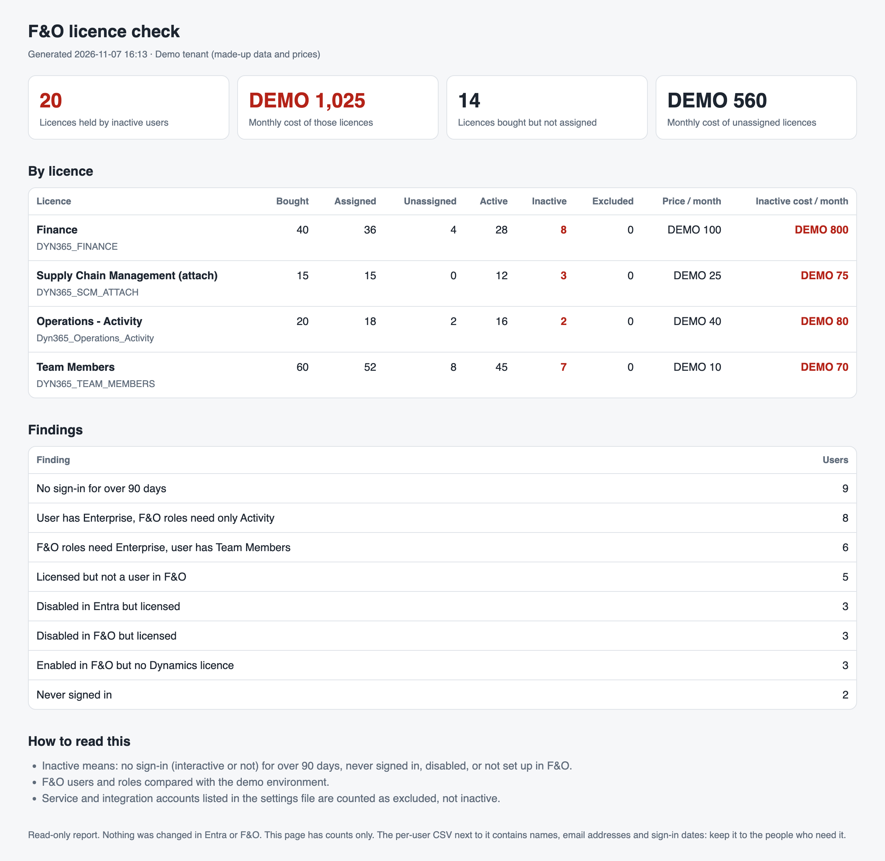

# F&O licence check

A free, read-only PowerShell script that shows which Dynamics 365 Finance and
Supply Chain Management (F&O) licences are paid for but not used, and what that
costs per month.



*The one-page summary, with made-up demo data and prices.*

## What problem this solves

Companies keep paying for F&O licences held by people who left, changed role or
never sign in. Nobody checks, because the facts sit in two places:

- **Entra** knows who holds a licence and when they last signed in.
- **F&O** knows who is still enabled, and which licence their security roles
  actually need.

This script reads both and puts them side by side.

## What it reports

Per user (in a CSV, for the licence owner):

| Finding | Why it matters |
|---|---|
| Never signed in | Waste, or an account set up and forgotten |
| No sign-in for over 90 days (you choose the number) | Likely to be removed |
| Disabled in Entra but licensed | Paying for someone who can't sign in |
| Licensed but not a user in F&O, or disabled in F&O | Paying for someone who can't use F&O |
| Enabled in F&O but no Dynamics licence | A compliance risk, the other way round |
| F&O roles need a higher licence than the user has | A compliance risk |
| User has a higher licence than their F&O roles need | A possible saving |

Per licence type (in a one-page HTML summary without names, for the business):
licences bought, assigned, active and inactive, and the monthly cost of the
inactive and unassigned ones.

The last two findings compare the user's licence with the licence type F&O
records for each of their security roles. Treat them as a starting point:
F&O's own user licence reports and your licensing partner have the final word.

## Try it in one minute

No sign-in needed. With [PowerShell 7](https://learn.microsoft.com/powershell/scripting/install/installing-powershell):

```powershell
git clone <repository-url>
cd d365fo-licence-check
./Get-FoLicenceCheck.ps1 -Demo
```

Open the files it writes to the `output` folder.

## Run it on your tenant

### 1. Install the modules (once)

```powershell
Install-Module Microsoft.Graph.Users, Microsoft.Graph.Identity.DirectoryManagement -Scope CurrentUser
Install-Module Az.Accounts -Scope CurrentUser   # only for the F&O comparison
```

### 2. Make your settings file

Copy `settings.example.json` to `settings.json` and fill in:

- **`inactiveDays`**: days without a sign-in that count as inactive (for example
  60 or 90).
- **`pricesPerMonth`**: your own price per licence per month. Prices differ per
  agreement, so the tool ships none. Leave a price empty to hide that cost.
- **`excludeUsers`**: service and integration accounts. They often look inactive
  but are needed.
- **`extraSkus`**: any other Dynamics licence to include, with a name and a tier
  (`Enterprise`, `Activity` or `Team Members`).

### 3. Run

```powershell
./Get-FoLicenceCheck.ps1 -TenantId contoso.onmicrosoft.com -SettingsFile ./settings.json `
    -FoEnvironmentUrl https://contoso-prod.operations.dynamics.com
```

Leave out `-FoEnvironmentUrl` to check Entra only.

### What you need

| For | You need |
|---|---|
| Entra | An admin who can consent to the read-only permissions `User.Read.All`, `AuditLog.Read.All` and `Organization.Read.All`. Global Reader or Reports Reader can run it once consent is given. |
| Sign-in dates | Entra ID P1 or P2. Without it, the script still runs but can't tell who is inactive by sign-in date. |
| F&O (optional) | Read access to the F&O environment with your normal account. The script reads the `SystemUsers` and `SecurityUserRoles` entities. |
| Your machine | PowerShell 7 on Windows, macOS or Linux. |

## How "inactive" is decided

- The **latest** of the interactive and non-interactive sign-in dates is used.
  People who use F&O only through Excel, Power BI or integrations have
  non-interactive sign-ins only, and would otherwise look inactive.
- A user is inactive if they never signed in, haven't signed in for longer than
  `inactiveDays`, are disabled in Entra, or (with the F&O check) are missing or
  disabled in F&O.
- Accounts in `excludeUsers` are counted as excluded, never as inactive.

## Safe to run

- **Read only.** The script only reads from Microsoft Graph and F&O (GET
  requests). A test checks that the code contains no write calls.
- **Nothing is sent anywhere.** The output stays on your machine.
- **Personal data.** The per-user CSV has names, email addresses and sign-in
  dates. Keep it to the people who need it, and delete it when you're done. The
  HTML summary has counts only, so it can be shared with the business.

## Tests

The logic is in a module (`src/FoLicenceCheck`) with [Pester](https://pester.dev)
tests that use fake Graph and F&O responses:

```powershell
Install-Module Pester -Scope CurrentUser -SkipPublisherCheck
Invoke-Pester ./tests
```

## Contributing

Issues and pull requests are welcome. Please run the tests first, keep the
script read-only, and never include tenant data or real prices in issues.

## Licence

[MIT](LICENSE). Free to use, change and share. This is a community project. It
isn't affiliated with or endorsed by Microsoft.
